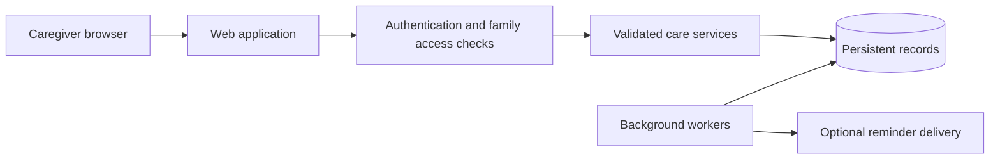

# Little Days

### Everyday care, remembered together.

Little Days is a family care tracker designed to make daily logging easier: feeding, sleep, pumping, growth and health, with shared history for caregivers.

**Public showcase · Private development · Fictional examples only**

This repository presents the product and selected engineering decisions. It is not a runnable application, a source-code release or a public deployment. Active development continues separately in a private repository.

## The product

| Area | What it supports |
|---|---|
| Feeding | Breast and bottle records, side-by-side breast timers, amounts and recent feeding summaries |
| Sleep | Start and finish tracking, manual records and a rolling 24-hour summary |
| Pumping | Left/right timing, expressed amounts and recent-session details |
| History | Calendar views, filters and shared care records |
| Growth | Measurements, trends and reference information |
| Medicines | A name/strength/form library, caregiver-entered courses, scheduled times, explicit dose recording and optional web push reminders |
| Family | Child profiles and shared caregiver access |

Timing language follows the activity: a completed session can show when it finished and how long it lasted; a medicine record preserves whether it was given, skipped or uncertain.

## A small example

The entries below are invented to illustrate the experience. They are not screenshots or exported care records.

| Card | Example content |
|---|---|
| Feeding | Bottle feed · 90 mL · finished 20 minutes ago |
| Sleep | Last sleep · 45 minutes · finished 10 minutes ago |
| Pumping | 60 mL total · 12-minute session · finished 30 minutes ago |
| History | Today's feeding, sleep and pumping records in one timeline |

## How it is built

The application uses TypeScript, React and Next.js, with server-side validation and SQLite persistence. Background workers support operational tasks and medicine reminders.

This is a conceptual architecture, not a deployment map. See [engineering notes](docs/ENGINEERING.md).

## Product principles

- Make common logging actions quick and understandable.
- Keep left/right controls spatially consistent.
- Distinguish planned activity from what a caregiver actually recorded.
- Keep unknown information explicit instead of guessing.
- Check the actual user journey as well as individual functions.

## Status and limits

Little Days is used in a private deployment and continues to evolve. This showcase does not establish commercial readiness, universal device compatibility, medical validation or guaranteed notification delivery. Medicine entries record caregiver-supplied instructions; the catalogue does not prescribe or calculate doses. Web push reminders are not alarms.

## Explore

- [Product journeys](docs/PRODUCT.md)
- [Engineering and validation](docs/ENGINEERING.md)
- [Showcase publication policy](SHOWCASE-POLICY.md)

The descriptions here are a curated snapshot. They are not automatically synchronized with development.
